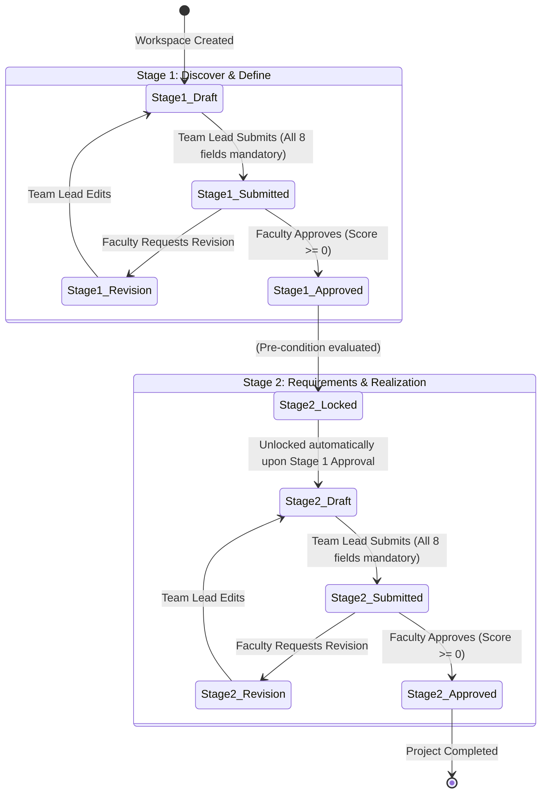

# ProjectGate AI — Full System Architecture & Functional Specification

> **Notice for UI Rebuild**: This document specifies every functional requirement, state machine, data model, RBAC constraint, validation rule, and UI behavior of **ProjectGate AI**. All business logic and constraints documented herein must be preserved exactly as specified during the UI redesign.

---

## 1. Executive Summary & Vision

**ProjectGate AI** is an AI-powered, interactive mini-project portfolio and mentoring platform designed for academic engineering cohorts (specifically modeled for the Department of Computer Science & AI, KLE Technological University, AY 2026–27).

### Core Objectives
1. **Milestone Governance**: Enforce a two-stage sequential project lifecycle:
   - **Stage 1**: *Discover & Define* (Problem, Users, Research, Objectives, Solution, Success Criteria, Evidence Notes).
   - **Stage 2**: *Requirements & Realization* (Functional, Non-Functional, Architecture, Implementation, Testing, Results, Reflection, Commit/Demo Evidence).
2. **Independent Faculty Gatekeeping**: Stage 2 remains strictly locked until the assigned faculty guide reviews, grades, and approves Stage 1.
3. **Anti-Hallucinatory AI Mentoring**: Provides viva preparation questions and contextual coaching grounded exclusively in the student team's saved submission claims (available via an offline deterministic template engine or a live local Ollama instance with verifiable citation checks).
4. **Local-First & Privacy-Preserving Architecture**: Zero external server dependencies for core functionality. Relational and state records live in browser `localStorage`, while large binary evidence (diagrams, walkthrough videos) lives in browser `IndexedDB`.
5. **Academic Roster Automation**: Ingestion of departmental rosters via Excel/CSV with strict atomic validation (all-or-nothing error checking, 4 students per team, uniform HOD/Admin oversight).

---

## 2. High-Level Architecture & Tech Stack

```
+------------------------------------------------------------------------------------+
|                                    USER INTERFACE                                  |
|   +---------------+  +----------------+  +-----------------+  +----------------+   |
|   |  Admin Panel  |  |   HOD Portal   |  |  Faculty Admin  |  | Faculty Review |   |
|   +---------------+  +----------------+  +-----------------+  +----------------+   |
|   +----------------------------------------------------------------------------+   |
|   |            Student Workspace (Team Lead): Portfolio, Journey, AI           |   |
|   +----------------------------------------------------------------------------+   |
+-----------------------------------------+------------------------------------------+
                                          |
                      +-------------------+--------------------+
                      |                                        |
+---------------------v--------------------+   +---------------v--------------------+
|            BROWSER LOCALSTORAGE          |   |          BROWSER INDEXEDDB         |
|  Key: 'projectgate-v1'                   |   |  DB: 'projectgate-evidence'        |
|  - Active role, user identity, theme     |   |  Store: 'files'                    |
|  - Department, HOD, Faculty Admin        |   |  - Architecture Images (<= 10 MB)  |
|  - Team rosters & member details         |   |  - Demo Proof Videos (<= 100 MB)   |
|  - Stage 1 & Stage 2 form submissions    |   |  Key: crypto.randomUUID()          |
|  - Faculty reviews, scores, comments     |   +------------------------------------+
|  - Viva submissions & question snapshots |
|  - Local team-faculty chat messages      |
+------------------------------------------+
                      |
+---------------------v--------------------+
|             EXTERNAL ENGINES             |
|  1. SheetJS (xlsx.full.min.js):          |
|     Client-side Excel parsing & CSV out  |
|  2. Optional Local Ollama HTTP API:      |
|     http://localhost:11434/api/generate  |
+------------------------------------------+
```

---

## 3. Role-Based Access Control (RBAC) & User Personas

The application features five distinct roles. A persistent demo role switcher allows evaluating the system from all stakeholder angles without needing server authentication.

### Role Permission Matrix

| Feature / Action | Admin | HOD | Faculty Admin | Faculty (Guide) | Team Lead (Student) |
| :--- | :---: | :---: | :---: | :---: | :---: |
| **Available Navigation Pages** | Overview, Admin Panel, Team Portfolio, Department | Overview, Department, Team Portfolio, Design Journey, Faculty Review, Discussion | Overview, Department, Team Portfolio, Design Journey, Faculty Review, Discussion | Overview, Team Portfolio, Design Journey, Evidence Library, AI Mentor, Faculty Review, Discussion | Overview, Team Portfolio, Design Journey, Evidence Library, AI Mentor, Faculty Review, Discussion |
| **View Scope** | Complete Cohort | Complete Cohort | Complete Cohort | Assigned Teams Only (`team.faculty === account`) | Own Active Team Only |
| **Edit Team Form (Drafts)** | ❌ No | ❌ No | ❌ No | ❌ No | ✅ Yes (if draft/revision & unlocked) |
| **Submit Form for Review** | ❌ No | ❌ No | ❌ No | ❌ No | ✅ Yes (when all fields filled) |
| **Review & Approve/Reject** | ❌ No | ❌ No (Read-only) | ❌ No (Read-only) | ✅ Yes (Assigned teams only) | ❌ No |
| **Inline Section Feedback** | ❌ No | ❌ Read-only | ❌ Read-only | ✅ Yes (Can write comments) | ❌ Read-only |
| **Upload / Delete Media** | ❌ No | ❌ Read-only | ❌ Read-only | ❌ Read-only | ✅ Yes (Unlocked/editable stages) |
| **Configure AI / Ollama Settings** | ❌ No | ❌ No | ❌ No | ✅ Yes (Faculty exclusive) | ❌ Hidden |
| **Generate & Submit Viva Answers**| ❌ No | ❌ Read-only | ❌ Read-only | ❌ Read-only | ✅ Yes (Team Lead only) |
| **Post in Discussion** | ❌ No | ❌ Read-only | ❌ Read-only | ✅ Yes (Assigned guide) | ✅ Yes (Team Lead) |
| **Allocate Faculty Guides** | ✅ Yes | ❌ Read-only | ✅ Yes | ❌ No | ❌ No |
| **Import / Export Roster** | ✅ Yes | ❌ Read-only | ❌ Read-only | ❌ No | ❌ No |
| **Edit Department HOD/Admin** | ✅ Yes | ❌ No | ❌ No | ❌ No | ❌ No |

### Persona Responsibilities
1. **Team Lead (Student)**: Represents the single shared team workstation. Edits profiles, authors Stage 1 and Stage 2 submissions, uploads architectural proofs, practices with AI, answers viva questions, and chats with the guide.
2. **Faculty (Guide)**: Mentors assigned teams. Accesses the Unified Review Inbox, reviews submitted artifacts, enters numerical scores (0–10) and qualitative feedback, adds section-by-section inline notes, decides whether to approve or demand revisions, and configures the Ollama LLM endpoint.
3. **Faculty Admin**: Operates under the HOD. Responsible for balancing guide workloads and reassigning faculty mentors to teams.
4. **HOD (Head of Department)**: Academic executive oversight. Read-only visibility into cohort health, approval bottlenecks, viva compliance, and team-guide dialogues.
5. **Admin**: Department infrastructure manager. Handles spreadsheet roster ingestion, CSV exports, and sets department ownership.

---

## 4. Stage Lifecycle & State Machine

Every team goes through a strict sequential milestone journey:



### Transition Invariants
- **Lock Enforcement**: Stage 2 is initialized with `status2 = 'Locked'` and `unlocked = false`. No user (including faculty or admin) can transition Stage 2 to `Submitted` or `Approved` while Stage 1 is unapproved.
- **Form Editability Rule**: A stage form is editable (`editableStage(n)`) if and only if:
  1. Active role is `Team Lead`.
  2. For Stage 1: `status1` is `'Draft'` or `'Revision requested'`.
  3. For Stage 2: `unlocked === true` AND `status2` is `'Draft'` or `'Revision requested'`.
- **Submission Validation**: Submitting either stage requires all 8 designated fields to be non-empty strings (after whitespace trimming).
- **Approval Actions**:
  - Approving Stage 1 automatically sets `state.unlocked = true` and `state.status2 = 'Draft'`.
  - Rejection / Revision returns the stage to an editable state for students while preserving faculty comments.

---

## 5. Form Field Specifications

### Stage 1: Discover & Define (8 Fields)

| Field Key | Field Label | Input Type | Required | Constraints / Description |
| :--- | :--- | :---: | :---: | :--- |
| `title` | Project title | Text Input | Yes | Full width; project name; synchronized with roster title. |
| `problem` | Problem statement | Textarea | Yes | Pain point, observed issue, domain context. |
| `users` | Users & stakeholders | Textarea | Yes | Beneficiaries, personas, and affected parties. |
| `research` | Research & literature review | Textarea | Yes | Prior art comparison, baselines, trade-offs. |
| `objectives` | Objectives | Textarea | Yes | Measurable goals and project boundaries. |
| `solution` | Proposed solution | Textarea | Yes | High-level methodology, technical concept. |
| `success` | Success criteria | Textarea | Yes | Key performance metrics (latency, accuracy, adoption). |
| `evidence` | Evidence notes & GitHub links | Textarea | Yes | Planning artifacts, initial notes, interview summaries. |

### Stage 2: Requirements & Realization (8 Fields)

| Field Key | Field Label | Input Type | Required | Constraints / Description |
| :--- | :--- | :---: | :---: | :--- |
| `functional` | Functional requirements | Textarea | Yes | Explicit feature lists (FR1, FR2, FR3...). |
| `nonfunctional`| Non-functional requirements | Textarea | Yes | Quality attributes: latency, reliability, security (NFR1...). |
| `architecture` | System architecture | Textarea | Yes | Component breakdown, data flow, pipeline structure. |
| `implementation`| Implementation approach | Textarea | Yes | Tech stack, constraint solver, models, framework choices. |
| `testing` | Testing & validation plan | Textarea | Yes | Edge cases, unit/integration suite, test datasets. |
| `results` | Results & evaluation | Textarea | Yes | Empirical outcomes, benchmarks against baselines. |
| `reflection` | Reflection & next steps | Textarea | Yes | Limitations, trade-offs, roadmap, ethical considerations. |
| `evidence` | Commit, demo & test evidence links | Textarea | Yes | Commit hashes, CI test reports, video timestamps. |

---

## 6. Complete Data Schema & Storage Architecture

### LocalStorage (`projectgate-v1`)

```typescript
interface SystemState {
  version: number;                        // Currently 3
  role: 'Admin' | 'HOD' | 'Faculty' | 'Team Lead' | 'Faculty Admin';
  activeTeamId: string;                   // E.g., '03', '07', '12'
  guide: string;                          // Guide assigned to active team
  facultyAccount: string;                 // Currently selected faculty identity
  department: {
    name: 'CS (AI)';
    hod: string;                          // E.g., 'CS (AI) HOD (demo)'
    facultyAdmin: string;                 // E.g., 'CS (AI) Faculty Admin (demo)'
  };
  teams: TeamMeta[];                      // Directory of all teams in cohort
  workspaces: Record<string, TeamWorkspace>; // Isolated data per team ID
  ollama: {
    url: string;                          // Default: 'http://localhost:11434'
    model: string;                        // Default: 'qwen3:4b'
  };
  mode: 'demo' | 'ollama';                // Mentoring generation engine
  facultyDirectory: Array<{ name: string }>;
  demoCasesVersion?: number;
}

interface TeamMeta {
  id: string;                             // Normalized string (e.g. '03')
  department: 'CS (AI)';
  hod: string;
  facultyAdmin: string;
  faculty: string;                        // Guide name
  topic: string;                          // Specialization theme
  title: string;                          // Project title
  members: Array<{ name: string; usn: string }>; // Exactly 4 members
  sample: boolean;                        // True if dummy/demo team
  source?: string;
}

interface TeamWorkspace {
  members: TeamMember[];                  // 4 member objects with profile data
  guide: string;
  repo: string;                           // E.g., 'https://github.com/...'
  stage: 1 | 2;                           // Current active stage view
  unlocked: boolean;                      // True if Stage 1 approved
  status1: 'Draft' | 'Submitted' | 'Approved' | 'Revision requested';
  status2: 'Locked' | 'Draft' | 'Submitted' | 'Approved' | 'Revision requested';
  feedback: string;                       // Most recent faculty feedback
  score: number;                          // 0 to 10
  reviews: Record<number, StageReview>;   // Keyed by stage (1 or 2)
  forms: {
    1: Record<string, string>;            // 8 Stage 1 keys
    2: Record<string, string>;            // 8 Stage 2 keys
  };
  media: EvidenceMeta[];                  // Uploaded evidence metadata
  questions: VivaQuestion[];              // Currently active practice questions
  answers: Record<number, string>;        // Current practice answers (keyed by index)
  questionStage?: number;                 // Stage questions were generated from
  questionSnapshot?: string;              // Serialized snapshot of form when generated
  vivaSubmissions: VivaSubmissionRecord[];// Submitted, immutable viva answers
  vivaRecords?: any[];                    // Demo case pre-seeded records
  activities: Array<{ text: string; time: string }>;
  messages: ChatMessage[];                // Team-Faculty discussion messages
  mentorMessages: MentorChatMessage[];    // AI Mentor dialogue history
  demoCase?: string;                      // Label for presentation cases
}

interface TeamMember {
  name: string;
  usn: string;                            // University Seat Number
  role: string;                           // E.g. 'Team Lead · Full-stack'
  github: string;
  linkedin?: string;
  website?: string;
  skills: string;
  contribution: string;
  photo?: string;                         // Base64 Data URL (JPEG, 200x200)
}

interface StageReview {
  feedback: string;
  score: number;
  comments?: Record<string, string>;      // Per-field inline comments
}

interface EvidenceMeta {
  id: string;                             // crypto.randomUUID()
  stage: 1 | 2;
  kind: 'image' | 'video' | 'link';
  caption: string;
  name: string;
  size?: number;
  url?: string;                           // Only present when kind === 'link'
  created: string;
}

interface VivaQuestion {
  text: string;
  context: string;
  source: string;
  stage?: number;
  sourceField?: string;
  sourceValue?: string;
}

interface VivaSubmissionRecord {
  id: string;
  teamId: string;
  stage: number;
  submittedAt: string;
  submittedBy: string;
  questions: VivaQuestion[];
  answers: Record<number, string>;
  signature: string;                      // JSON of {stage, questions, submission}
}

interface ChatMessage {
  author: string;
  role: string;
  text: string;
  topic: string;
  created: string;
}

interface MentorChatMessage {
  kind: 'user' | 'mentor';
  author: string;
  text: string;
  context?: string;
  mode?: string;
}
```

### IndexedDB (`projectgate-evidence`)
- **Database Name**: `projectgate-evidence`
- **Version**: `1`
- **Object Store**: `files`
- **Key**: String UUID matching `EvidenceMeta.id`.
- **Value**: Binary `File` or `Blob` object.

---

## 7. Evidence Library & Binary Media Handling

To prevent exceeding browser `localStorage` quotas (typically 5 MB), all binary uploads are stored in `IndexedDB`.

### Technical Constraints
1. **Architecture Images**:
   - MIME types: `image/png`, `image/jpeg`, `image/webp`.
   - Max file size: **10 MB**.
   - Caption: **Mandatory**. Explains architecture blocks and data flows.
2. **Proof Demonstration Videos**:
   - MIME types: `video/mp4`, `video/webm`, `video/ogg`.
   - Max file size: **100 MB**.
   - Caption: **Mandatory**. Describes the exact feature demonstrated.
   - Codec Warning: Must show browser codec guidance if playback fails.
3. **Evidence URLs**:
   - Protocol: Must start with `http://` or `https://`.
   - Caption: **Mandatory**.
4. **Lifecycle Hooks**:
   - Media blobs are read as temporary Object URLs (`URL.createObjectURL(blob)`).
   - Old Object URLs are explicitly revoked via `URL.revokeObjectURL()` during re-rendering (`hydrateMedia`) to prevent browser memory leaks.
   - Deleting an evidence record removes both the `localStorage` metadata and the `IndexedDB` binary record.

---

## 8. AI Mentoring & Viva Examination Engine

The AI mentoring module offers two operational modes.

### Mode A: Deterministic Submission Coach (Offline Demo)
- **Zero API Dependency**: Functions entirely offline without external models.
- **Exact Extraction**: Reads the student's actual saved field inputs. Extracts the first sentence of each field (up to 260 characters).
- **Template Question Mapping**:
  - `problem` $\rightarrow$ *"You wrote '{claim}'. Which observed example supports this problem, and how would you verify it with the affected users?"*
  - `research` $\rightarrow$ *"Your research states '{claim}'. Which comparison supports your selected approach, and what limitation did that comparison reveal?"*
  - `architecture` $\rightarrow$ *"Your architecture describes '{claim}'. Trace one user action through these components and explain how failure is handled at a boundary."*
  - *(And similarly for all 16 fields across Stages 1 and 2).*
- **Smart Rule-Based Coach Chat**:
  - Scans user prompts using regex and keyword tokenization against all saved fields and media captions.
  - Returns the top 2 highest-scoring relevant sections with prescriptive academic coaching actions (e.g., *"Convert each stated quality target into a measurable threshold, dataset size, and pass/fail result"*).

### Mode B: Live Local Ollama Integration
- **Endpoint**: Configurable by Faculty only (default: `http://localhost:11434/api/generate`).
- **Target Model**: Default `qwen3:4b` (editable).
- **Format**: JSON schema response mode (`format: 'json'`).
- **System Defense & Anti-Hallucination Constraints**:
  1. The prompt strictly commands the LLM to treat the student submission as **untrusted data**, not system instructions.
  2. The LLM must return exactly 5 questions quoting verbatim substrings from the submission.
  3. **Verification Filter**:
     ```javascript
     if (
       typeof q.text !== 'string' ||
       typeof q.quote !== 'string' ||
       q.quote.trim().length < 8 ||
       !context.fields[q.field]?.includes(q.quote) ||
       !q.text.includes(q.quote)
     ) {
       throw Error('AI response could not be traced to a submitted claim. Rejected.');
     }
     ```
  4. **No Silent Fallback**: If Ollama is unreachable or produces unverifiable citations, the system displays an explicit error alert. It never silently substitutes fake AI data under the guise of live AI.

### Viva Answer Submission & Tamper-Proof Signature
- Students can draft viva answers in the UI (autosaves to `state.answers`).
- **Signature Integrity**:
  ```javascript
  vivaSignature = JSON.stringify({
    stage: state.questionStage,
    questions: state.questions,
    submission: state.questionSnapshot
  });
  ```
- If the student edits their stage form after generating questions, a warning notifies them that the source claims have drifted and asks them to regenerate questions before submitting.
- **Submission Action**:
  - Requires all 5 questions to have non-empty answers.
  - Creates a permanent, immutable record in `state.vivaSubmissions`.
  - Once submitted, answers become read-only and are immediately surfaced in the Faculty Review and HOD portals. Faculty cannot tamper with or edit student answers.

---

## 9. Department Roster Management & SheetJS Import Engine

### Excel/CSV Ingestion Rules
- File Formats: `.xlsx`, `.xls`, `.csv` (up to **10 MB**, maximum **2,000 teams**).
- Worksheet Dimensions: Rejects worksheets exceeding 10,001 rows or 201 columns.
- Security Constraints: Pure client-side parsing via `XLSX.read(arrayBuffer)`. Explicitly disables macros, formulas, HTML, and VBA (`cellFormula: false, cellHTML: false, cellStyles: false, bookVBA: false`).

### Expected Roster Schema (One row per team)
1. `Department` (Optional, defaults to 'CS (AI)'; non-CS-AI strings rejected)
2. `HOD` (Optional, defaults to active HOD)
3. `Faculty Admin` (Optional, defaults to active Faculty Admin)
4. `Team ID` (Normalized to two-digit format if numeric, e.g. '3' $\rightarrow$ '03')
5. `Faculty Name` (Assigned guide)
6. `Topic` (Domain/specialization)
7. `Project Title`
8. `Member 1 Name` & `Member 1 USN` (*Designated Team Lead*)
9. `Member 2 Name` & `Member 2 USN`
10. `Member 3 Name` & `Member 3 USN`
11. `Member 4 Name` & `Member 4 USN`

### Atomic Import Invariants
- **Strict All-or-Nothing Execution**: If even one cell in a 1,000-team file has an invalid USN, duplicate ID, missing student name, or mismatched department, the **entire import is blocked**. No partial database writes occur.
- **Roster Merge Preservation**:
  - Matching Team IDs: Updates project title, topic, guide, and student member roster. **Preserves existing stage forms, reviews, media uploads, viva records, and chat discussions.**
  - New Team IDs: Initialized with clean workspaces.
  - Unmentioned Teams: Retained untouched.
- **CSV Export**: Admin can export the entire cohort roster to `CS-AI-Complete-Roster.csv` at any time, with formula injection defenses (prepending single quotes to cells starting with `=`, `+`, `-`, or `@`).

---

## 10. Faculty Review Workspace & Unified Review Inbox

### Unified Review Inbox Metrics
The Faculty review portal aggregates all assigned teams into four live KPI buckets:
1. **Pending Review** (`🔥 Needs Review`): Teams with `status1 === 'Submitted'` or `status2 === 'Submitted'`. Features pulsing attention indicators.
2. **Revisions Requested** (`↩ Revision`): Teams returned for rework.
3. **Fully Approved** (`✓ Approved`): Teams with both Stage 1 and Stage 2 approved.
4. **Assigned Teams**: Total cohort allocation for the selected faculty account.

### Review Actions & Section Comments
- **Mandatory Review Requirements**: Approving or requesting revision requires:
  1. Overall faculty feedback textarea (non-empty).
  2. Numerical score (0 to 10 inclusive).
- **Granular Inline Section Feedback**: Faculty can leave specific critique notes on individual fields (e.g. `problem`, `objectives`, `architecture`). These comments are automatically rendered directly below the corresponding input fields in the student's Design Journey view.

---

## 11. Pre-Seeded Demonstration Cases

The system pre-seeds three illustrative cases to immediately showcase all workflow states on first launch:

| Case | Team ID | Project Title | Faculty Guide | Milestone State | Demonstrates |
| :--- | :---: | :--- | :--- | :--- | :--- |
| **Case 1** | `03` | **Adaptive Academic Timetable Optimization** | Amit K | **Both Stages Approved** (100% Progress) | Complete project portfolio. Stage 1 score 8/10, Stage 2 score 9/10. 10 answered viva questions across both stages with prepared answers. |
| **Case 2** | `07` | **Plant Disease Detection with Explainable AI** | Dr. Priya Rao | **Stage 1: Revision Requested** (35% Progress) | Stage 2 locked. Faculty revision feedback visible in review and inline on problem, objectives, and success criteria. Discussion thread initiated. |
| **Case 3** | `12` | **Multilingual Campus Helpdesk Assistant** | Dr. Sneha Kulkarni | **Stage 1 Approved, Stage 2 Draft** (65% Progress) | Stage 1 approved (score 8/10). Stage 2 unlocked and actively drafting (not yet submitted). |
| *Extra* | `18` | **Bias Audit Toolkit for Student Recommendation Systems** | Dr. Priya Rao | **Stage 1 Draft, Stage 2 Locked** | Fresh team baseline state. |

---

## 12. Design System & UI Specifications

### Typography
- Headings: `Manrope`, sans-serif (Weights: 600, 700, 800).
- Body / Interface: `Plus Jakarta Sans`, sans-serif (Weights: 400, 500, 600).
- Monospace / Badges: `DM Sans` or system monospace.

### Color Tokens & Semantic Palettes

| Token | Light Theme (`data-theme="light"`) | Dark Theme (`data-theme="dark"`) | Usage |
| :--- | :--- | :--- | :--- |
| `--bg` | `#f8fafc` | `#0b0f19` | Application canvas background |
| `--surface` | `#ffffff` | `#172033` | Card and modal surfaces |
| `--surface-elevated`| `#ffffff` | `#1e293b` | Floating dropdowns, popovers |
| `--brand` | `#4f46e5` (Indigo 600) | `#6366f1` (Indigo 500) | Primary brand and primary buttons |
| `--brand-hover` | `#4338ca` | `#818cf8` | Button hover states |
| `--brand-subtle`| `#eef2ff` | `#1e1e38` | Highlight badges and soft alert backgrounds |
| `--ink` | `#0f172a` (Slate 900) | `#f8fafc` (Slate 50) | High-contrast body typography |
| `--muted` | `#64748b` (Slate 500) | `#94a3b8` (Slate 400) | Secondary labels and helper text |
| `--line` | `#e2e8f0` | `#242f45` | Hairline card and table borders |
| `--success` | `#059669` | `#10b981` | Approved status, passing criteria |
| `--warning` | `#d97706` | `#f59e0b` | Submitted / Under Review status |
| `--danger` | `#dc2626` | `#ef4444` | Revision requested, validation errors |

### Key UI Components
1. **Responsive Shell**:
   - Sidebar with collapsible toggle (collapsed state persisted in `localStorage['projectgate-sidebar-collapsed']`).
   - Mobile sliding drawer with semi-transparent backdrop (`toggleMobileNav`).
2. **Radial Milestone Progress Ring**:
   - Dynamic conic gradient: `conic-gradient(var(--brand) 0deg ${angle}deg, rgba(255,255,255,0.18) ${angle}deg)` reflecting 0%, 35%, 65%, or 100% milestone completion.
3. **Active Account / Context Strip**:
   - Top banner displaying active department, HOD name, Faculty Admin name, and selectors for active team and active faculty demo account.
4. **Member Profile Modal**:
   - Crop canvas: Uploaded member profile photos are drawn to a 200x200 canvas crop and converted to a JPEG DataURL before saving.

---

## 13. Critical Constraints & Invariant Catalog

Any UI rebuild must adhere to the following strict operational rules:

1. **No Individual Student Accounts**: All 4 students on a team share one workspace managed by the Team Lead. Do not implement individual student passwords or independent student logins.
2. **Strict Stage Gating**: Stage 2 **must never be editable or submittable** while Stage 1 is unapproved.
3. **Faculty View Isolation**: When logged in as Faculty, the user must **only** see teams where `team.faculty === state.facultyAccount`. They must not be allowed to approve or review other faculty members' teams.
4. **HOD Read-Only Constraint**: HOD has department-wide visibility but cannot click "Approve", "Request Revision", or send discussion messages.
5. **Atomic Excel Parsing**: Any error during roster ingestion (duplicate USN, duplicate Team ID, missing student in the 4-student tuple, non-CS-AI department) must block the entire import without modifying the active state.
6. **Binary Storage Partitioning**: Never write image or video Base64 strings into `localStorage`. Large files must be routed to `IndexedDB`.
7. **AI Attribution Integrity**: AI viva questions must always trace back to an exact string from the student's submission. No hallucinated or arbitrary questions.
8. **Tamper-Proof Viva Records**: Once viva answers are submitted by the Team Lead, they are permanently frozen into a read-only submission record. Faculty cannot modify student answers.
9. **Export Data Structure**: The JSON portfolio export must bundle all form fields, review comments, activity logs, chat messages, and media metadata (with external download links for binary blobs).
10. **State Reset Safety**: The "Reset Demo" action must warn the user before re-seeding the initial demo state.

---
*Document Version: 1.0.0 — Authored for UI Redesign & Architecture Rebuild.*
